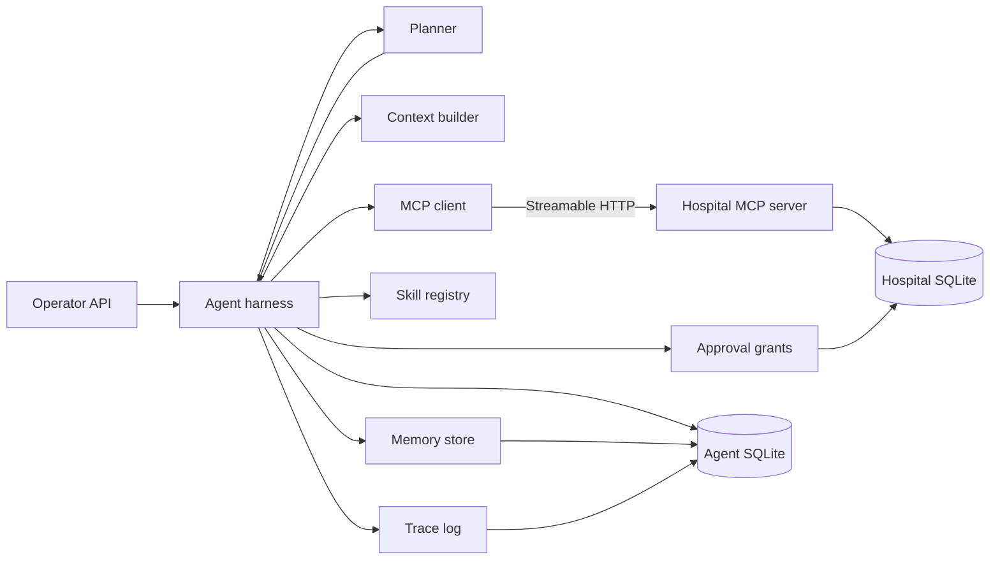

# Healthcare Operations Agent

Administrative automation for a synthetic hospital. An operations coordinator receives a natural-language request, breaks it into specialist steps, and executes those steps by calling a **separately running MCP server**. Cancellations, reschedules, and patient-information changes pause for a named human approver and then resume from the saved run. The system does not diagnose, triage, or recommend treatment.

Everything in the database is fictional. Demo mode loads those fixtures and selects the deterministic planner when no model key is set. It does not skip approvals and it does not invent a date of birth, member id, or slot.

## Architecture



The hospital process and the agent process do not share Python calls. The agent discovers tools and resources with the official MCP Python SDK (`mcp` 2.x, `MCPServer`, Streamable HTTP) and invokes them with `tools/call`. Sensitive tools re-check a one-time grant whose hash is bound to the approved arguments. A model-supplied `grant_id` is discarded before that check.

Two planners share that harness:

| Planner | When it runs | What it decides |
| --- | --- | --- |
| Deterministic | `PLANNER_MODE=deterministic`, or `auto` with no `LLM_API_KEY` | Parses the demo and evaluation phrases into an explicit plan. Useful for a recruiter demo and for tests that must not depend on a model. |
| OpenAI-compatible | `PLANNER_MODE=llm`, or `auto` when `LLM_API_KEY` is set | Sends the bounded context and the **discovered** tool schemas to `POST /chat/completions`. The model may choose a tool. The harness still validates arguments, enforces allow-lists, and holds sensitive calls for approval. |

Retrieval of past runs is not training. The README and the code both keep those ideas separate.

## Request path

1. `POST /api/v1/agents/run` stores a run and opens an MCP session.
2. The client lists tools and reads `hospital://` resources. Resource text is refreshed into semantic memory and wrapped as untrusted context.
3. The deterministic planner either asks for missing fields or builds specialist steps (`patient_operations`, `scheduling`, `insurance_operations`, `operations_coordinator`). The LLM planner loops on tool calls instead.
4. Each call is checked against the specialist allow-list and the JSON Schema advertised by MCP. Invalid arguments are traced as `argument_rejected` and are not sent.
5. Tools in the sensitive set pause the run. `POST /api/v1/approvals/{id}/approve` writes a grant, then the same run continues at the saved cursor. Reject leaves the hospital row unchanged.
6. A `SLOT_UNAVAILABLE` result on a new booking triggers one recovery: read availability again and book the next open slot.
7. The run writes a redacted trace, working memory, and an episodic record.

The iteration cap defaults to 12. Transport failures retry at most twice. Business errors such as "patient not found" are not retried.

## Skills

Skills live in `app/skills/registry.py`. They name the inputs, tools, preconditions, and failure behavior. They do not talk to the database.

| Skill | Specialist | Tools |
| --- | --- | --- |
| `patient_intake` | Patient operations | `register_patient`, `search_patients` |
| `appointment_scheduling` | Scheduling | availability, `schedule_appointment`, search |
| `appointment_rescheduling` | Scheduling | list, availability, `reschedule_appointment` |
| `insurance_verification` | Insurance operations | eligibility and coverage |
| `patient_follow_up` | Coordinator | `create_administrative_task` |

## MCP server

Run it on its own:

```bash
python -m mcp_server
```

Streamable HTTP is served at `http://127.0.0.1:8765/mcp`. The SDK choice is the current `MCPServer` API in mcp 2.x (`FastMCP` was renamed). JSON responses and stateless HTTP are enabled so each client session is an independent MCP handshake.

| Tool | Effect | Grant |
| --- | --- | --- |
| `search_patients` | Find by name, MRN, id, or phone | no |
| `get_patient_details` | Read one patient | no |
| `register_patient` | Create a patient, or replay the same identity | no |
| `update_patient_information` | Change demographics or insurance ids | yes |
| `get_doctor_availability` | Open future slots | no |
| `list_appointments` | List visits | no |
| `schedule_appointment` | Book an open slot | no |
| `reschedule_appointment` | Move a visit | yes |
| `cancel_appointment` | Cancel and release the slot | yes |
| `verify_insurance_eligibility` | Synthetic eligible / ineligible / unknown | no |
| `get_insurance_coverage` | Synthetic coverage fixture | no |
| `get_claim_status` | Synthetic claim fixture | no |
| `create_administrative_task` | Operations follow-up | no |
| `get_administrative_task_status` | Read that task | no |

Resources:

- `hospital://policies/appointment-rules`
- `hospital://policies/insurance-rules`
- `hospital://directory/doctors`

Seeded people and fixtures (all synthetic):

| Record | Id | Notes |
| --- | --- | --- |
| Maria Alvarez | `PAT-MARIA` / `MRN-1001` | BlueHarbor `BH-100100`, eligible |
| Samir Patel | `PAT-SAMIR` / `MRN-1002` | Northwind `NW-100100`, ineligible; visit `APT-SAMIR` |
| Elena Rossi | `PAT-ELENA` / `MRN-1003` | Visit `APT-ELENA` with Dr. Amelia Chen |
| Demo member | `BH-100200` | Eligible BlueHarbor member with no patient until a run registers one |
| Closed slot | `SLT-CLOSED` | Already booked, used to show recovery |
| Claims | `CLM-5001` paid, `CLM-5002` pending | |

Clinicians: Amelia Chen and Luis Ortega (Cardiology), Priya Shah (Family Medicine), Noah Williams (Orthopedics). Slots are generated for the next five weekdays so the demo does not rot.

## API

Interactive docs: `http://127.0.0.1:8091/docs`.

| Method | Path | Purpose |
| --- | --- | --- |
| `POST` | `/api/v1/agents/run` | Start a run |
| `GET` | `/api/v1/agents/runs` | List runs and traces |
| `GET` | `/api/v1/agents/runs/{run_id}` | One run, including the trace |
| `GET` | `/api/v1/approvals/pending` | Queue |
| `POST` | `/api/v1/approvals/{approval_id}/approve` | Record the approver and resume |
| `POST` | `/api/v1/approvals/{approval_id}/reject` | Record the rejection and stop |
| `GET` | `/api/v1/patients` | Operator view of the hospital file |
| `GET` | `/api/v1/appointments` | Operator view of visits |
| `GET` | `/api/v1/health` | Process and MCP reachability |

`GET /patients` and `GET /appointments` are operator reads. Agent mutations go through MCP. Traces redact phone, email, address, date of birth, and member id. The operator list shows the synthetic source rows so a demo can be inspected.

Example:

```bash
curl -s http://127.0.0.1:8091/api/v1/health
curl -s -X POST http://127.0.0.1:8091/api/v1/agents/run \
  -H 'content-type: application/json' \
  -d '{"request":"Find the patient named Maria Alvarez and show her profile.","actor":"demo.operator"}'
```

## Run it locally

Python 3.12 or newer.

```bash
python -m venv .venv
source .venv/bin/activate
pip install -e ".[dev]"
cp .env.example .env
python scripts/seed_database.py
```

Terminal A:

```bash
python -m mcp_server
```

Terminal B:

```bash
uvicorn app.main:app --host 0.0.0.0 --port 8091
```

Terminal C, against a **fresh** seed so Elena's visit still exists:

```bash
python scripts/demo.py
python scripts/run_evaluations.py
pytest
```

`scripts/demo.py` does three things:

1. Sends the incomplete John Smith request and shows the missing date of birth, member id, and payer. No patient is created.
2. Sends the same request with those fields filled in. The agent registers him, checks `BH-100200`, and books the earliest cardiology slot.
3. Asks to cancel Elena Rossi. The run pauses. The script approves as `demo.lead@example.test` and the cancellation then happens.

`scripts/run_evaluations.py` starts its own MCP server on a temporary database, so it will not wipe the demo file. It writes `reports/evaluation-report.md` and `reports/evaluation-report.json`.

### Docker

```bash
docker compose up --build
```

The API listens on port `8091` and the MCP server on port `8765`. Both share one volume. Set `API_BASE_URL=http://127.0.0.1:8091` for the demo script.

### Model key

Leave `LLM_API_KEY` empty to stay on the deterministic planner. To use a model:

```bash
LLM_API_KEY=sk-... LLM_BASE_URL=https://api.openai.com/v1 LLM_MODEL=gpt-4o-mini PLANNER_MODE=auto
```

Any OpenAI-compatible chat-completions endpoint works. The key is read from the environment only.

## Evaluation

Twenty-one scenarios assert database state and trace order. None of them is a hardcoded success flag. Metrics:

- task completion, from the expected terminal status plus the business assertion
- tool-selection accuracy, from the ordered tool list
- argument validity, including a call the schema rejects before MCP sees it
- workflow correctness
- policy compliance, from "a sensitive success must be preceded by an approval event"
- approval compliance, including a rejection that must not cancel
- latency, tool-call count, failures, and recovery

Covered situations include search, registration, scheduling, reschedule-with-approval, cancel-with-approval, eligibility, coverage, a missing patient, a booked slot, a specialty with no inventory, the multi-step intake, missing personal data, episodic reuse of the patient just registered, a follow-up task, a prompt-injection attempt, phone-update redaction, the iteration cap, and a specialist calling a tool outside its allow-list.

The checked-in report is `reports/evaluation-report.md`. On the last run, 21 of 21 scenarios passed. Task completion, tool selection, workflow correctness, policy compliance, and approval compliance were all 1.0. Every call that reached MCP had valid arguments. Proposal validity is below 1.0 on purpose: the invalid-argument scenario is a bad proposal that the harness blocks, and that blocked proposal is counted. The failure-recovery rate is below 1.0 because an unknown patient is a real tool failure that should not be retried, while the booked-slot failure is recovered once.

## Project map

```text
app/api/            FastAPI routes
app/harness/        execution loop, summaries
app/orchestration/  parser, deterministic plan, LLM client
app/mcp_client/     Streamable HTTP MCP client
app/memory/         working, episodic, and semantic stores
app/skills/         skill registry
app/context/        token-budget context builder
app/evaluations/    scenarios, metrics, markdown report
app/observability/  redacted traces
app/security/       allow-lists, injection flags, redaction
mcp_server/         independent hospital MCP server
tests/unit/         parser, policies, repository
tests/integration/  live MCP protocol, API, eval suite, LLM stub
scripts/            seed, demo, evaluations
```

## Memory

| Kind | Contents | Store |
| --- | --- | --- |
| Working | Facts and cursor for the open run | `working_memory` |
| Episodic | Request, summary, status, and non-secret facts such as patient id and MRN | `episodic_memories` |
| Semantic | Appointment rules, insurance rules, and the directory, refreshed from MCP resources | `semantic_memories` |

`MemoryStore.retrieve` scores keyword overlap. A vector index can replace that method without changing the harness. The phrase "the patient I just registered" resolves a patient id that a previous tool call actually returned.

## Security boundaries

- Pydantic validates HTTP bodies. MCP validates tool arguments again from the function signature. The harness validates the discovered JSON Schema before the call and strips any model-supplied `grant_id`.
- Specialist allow-lists are code, not prompt text. The patient agent cannot cancel.
- Retrieved policies and memories are wrapped in `<untrusted_content>`. The system instructions say they cannot override approval rules. The harness does not consult the model to decide whether a grant is required.
- Injection phrases are flagged on the run. "Skip the approval" still pauses.
- Traces and logs pass through `redact`.
- SQLite runs in WAL mode with a busy timeout so the API and the MCP server can share the hospital file. The only agent write to that file is the approval grant.

## Limitations

- The deterministic parser covers the phrases in the demo and the evaluation suite. Open-ended wording needs the LLM planner.
- A run that is waiting for missing fields does not resume in place. Send a new request that includes the fields. Approval pauses do resume.
- Token estimates are `len(text) / 4`, not a model tokenizer.
- Memory search is lexical. There is no embedding index and no claim of learning.
- The hospital store is SQLite. The repositories use SQLAlchemy, so a Postgres URL is a deployment change, not a redesign, but this MVP does not ship a Postgres service.
- There is no end-user login on the API. Publish it as a private Cursor app, or keep it on localhost.
- Insurance answers are fixtures. They are not benefit determinations.

## Applied AI Engineering Competency Matrix

| Requirement | Concept | Where it lives | What proves it |
| --- | --- | --- | --- |
| Natural-language administrative requests | Intent parsing plus an optional tool-calling model | `app/orchestration/parsing.py`, `app/orchestration/llm.py` | `tests/unit/test_parsing_and_context.py`, `tests/integration/test_llm_planner.py`, `scripts/demo.py` |
| Multi-step planning | Coordinator plan with specialist steps | `app/orchestration/deterministic.py`, `app/harness/engine.py` | Scenario `multi-step-intake` |
| Tool selection and execution | Harness loop, discovered schemas, MCP `tools/call` | `app/harness/engine.py`, `app/mcp_client/gateway.py` | `tests/integration/test_mcp_protocol.py`, evaluation tool-selection metric |
| Custom MCP server | Independent process, official SDK, Streamable HTTP | `mcp_server/server.py`, `mcp_server/tools.py`, `mcp_server/__main__.py` | Protocol test discovers tools and reads resources over HTTP |
| MCP resources | Policies and directory fetched by the client | `mcp_server/resources.py` | Context trace `context_built`; resource URIs in the protocol test |
| Tool-argument validation | JSON Schema from discovery, before the call | `validate_arguments` in `app/harness/engine.py` | Scenario `invalid-arguments` |
| No arbitrary code from the model | Allow-list plus schema. No `exec` | `app/security/authorization.py` | Scenario `specialist-allow-list` |
| Specialist agents | Patient, scheduling, insurance, coordinator | `app/agents.py`, `AGENT_TOOLS` | Plan steps record `agent_id`; allow-list test |
| Skills | Registry separate from tools | `app/skills/registry.py` | Preconditions fail closed; follow-up scenario uses `patient_follow_up` |
| Working memory | Current facts and cursor | `app/memory/store.py` | Resume uses `state_json` and working rows; approval scenarios |
| Episodic memory | Prior runs, not weights | `EpisodicMemoryRecord` | Scenario `episodic-memory` |
| Semantic memory | Policies and directory, keyword retrieval, vector-ready interface | `MemoryStore.retrieve` | Resources upserted at the start of each run |
| Context engineering | Priority, budget, trusted vs untrusted | `app/context/builder.py` | `test_context_budget_drops_lower_priority_sections_and_marks_untrusted_text` |
| Human approval | Pause, grant, resume, record approver and time | `ApprovalRecord`, `mcp_server/security.py` | `reschedule-with-approval`, `cancel-with-approval`, `update-phone-with-approval`, `reject-and-ignore-injection` |
| Tool-level authorization | MCP tool rejects a cancel with no grant | `consume_grant` | `tests/unit/test_repository.py`, protocol test cancel |
| Failure recovery | One retry onto the next open slot | `_recover_schedule` | Scenario `slot-conflict-recovery` |
| Iteration, timeout, retry limits | Harness settings | `Settings`, `_call_mcp`, `McpGateway.call_tool` | Scenario `iteration-limit` |
| Idempotency | Register and schedule keys | `mcp_server/repository.py` | Repository tests |
| Structured traces | Run, agent, tool args, result, latency, errors, approvals | `app/observability/tracing.py` | Every run payload's `events`; phone number absent from the update trace |
| Redaction | Phone, email, address, DOB, member id | `app/security/redaction.py` | Unit redaction test; `check_phone` |
| Prompt-injection handling | Flag plus policy that does not live in the prompt | `app/security/guardrails.py` | Scenario `reject-and-ignore-injection` |
| Evaluation beyond a plausible answer | Database assertions and trace metrics | `app/evaluations/` | `pytest` scenario `test_evaluation_suite`; `reports/evaluation-report.md` |
| Observability for a recruiter | JSON logs and per-run trace | `app/logging_config.py` | `GET /api/v1/agents/runs/{run_id}` |
| Missing data | Stop and ask | `missing_fields` | Demo step 1; scenario `missing-personal-data` |
| Synthetic, non-clinical scope | Fixtures and policy text | `mcp_server/seed.py` | Copy in the tool descriptions and this README |

## License

The code in this repository is the project source for the demo. The hospital records it generates are synthetic and are not a medical device, a coverage decision, or a real directory.
